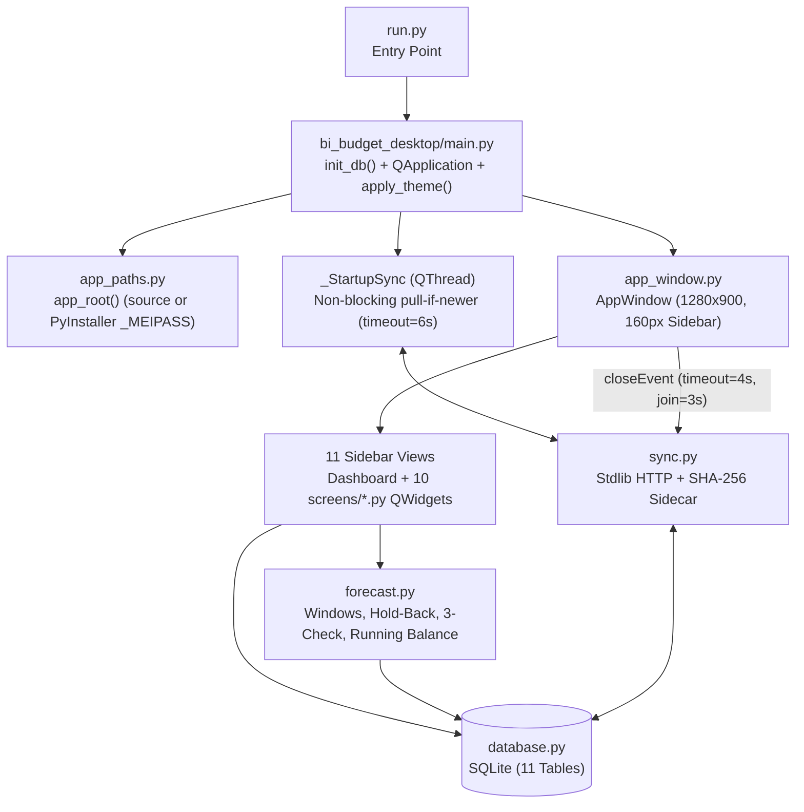

<p align="center">
  <a href="https://ko-fi.com/todd0042">
    
  </a>
</p>

---

# 💰 Bi-Budget Desktop

[]()
[](LICENSE)
[](build.sh)
[](requirements.txt)
[-41cd52.svg)](requirements.txt)
[](bi_budget_desktop/database.py)
[](https://ko-fi.com/todd0042)

> **A calm, local-first PySide6 desktop budget planner built around real 14-day bi-weekly paychecks—telling you what is truly safe to spend, when bills hit, how much to hold back for lean cycles, and when your next 3-paycheck month arrives.**

---

## 📖 Table of Contents

* **Part 1 — User Overview & Quick Start**
  * [💰 What Is Bi-Budget Desktop?](#-what-is-bi-budget-desktop)
  * [🔄 How It Works in 3 Steps](#-how-it-works-in-3-steps)
  * [✨ Key Features at a Glance](#-key-features-at-a-glance)
  * [🚀 Quick Start, Installation & Portable Builds](#-quick-start-installation--portable-builds)
* **Part 2 — Technical Architecture & Reference**
  * [1. Application Lifecycle & Desktop Shell ([run.py](run.py), [main.py](bi_budget_desktop/main.py), [app_window.py](bi_budget_desktop/app_window.py))](#1-application-lifecycle--desktop-shell)
  * [2. Bi-Weekly Forecasting, Rolling Hold-Back & Running Balance Engine ([forecast.py](bi_budget_desktop/forecast.py))](#2-bi-weekly-forecasting-rolling-hold-back--running-balance-engine)
  * [3. Screens & Interactive Modules ([screens/](bi_budget_desktop/screens/))](#3-screens--interactive-modules)
  * [4. Local SQLite Schema, Paths & Migrations ([database.py](bi_budget_desktop/database.py), [migrations/](bi_budget_desktop/migrations/))](#4-local-sqlite-schema-paths--migrations)
  * [5. Cross-Device Whole-File Sync Protocol ([sync.py](bi_budget_desktop/sync.py))](#5-cross-device-whole-file-sync-protocol)
  * [6. Themes, Assets & Packaging ([themes/](themes/), [icons/](icons/), [build.sh](build.sh))](#6-themes-assets--packaging)
  * [7. Repository Structure](#7-repository-structure)
  * [8. Verification & Sanity Checks](#8-verification--sanity-checks)
  * [9. License & Support ([LICENSE](LICENSE))](#9-license--support)

---

# Part 1 — User Overview & Quick Start

## 💰 What Is Bi-Budget Desktop?

**Bi-Budget Desktop** (`Bi-Budget Desktop`, `Version 1.0a`) is a cross-platform desktop personal finance application built with **PySide6 (Qt 6)** and **SQLite** for people paid on a **bi-weekly (14-day)** schedule.

Traditional monthly budgeting tools assume paychecks land on the 1st and 15th. In reality, bi-weekly paychecks drift across calendar months—causing uneven bill clusters in some two-week windows and occasional "3-paycheck months" twice a year. Bi-Budget models each income source on its true 14-day cycle and answers one practical question:

> **How much money from this paycheck is genuinely safe to spend after upcoming bills, average paycheck spending, planned savings, and any needed hold-back reserve?**

All data lives locally in a single SQLite database (`bi_budget.db`), with zero bank scraping, zero mandatory cloud accounts, full CSV export, 19 built-in themes, and optional self-hosted sync against a `bi-budget-sync` server.

---

## 🔄 How It Works in 3 Steps

1. **Add Your Bi-Weekly Income Sources & Baseline Spending**: Open the **Income** screen, add one or more bi-weekly paychecks (with amount, per-check planned savings, and next pay date), and set your average discretionary spending per paycheck.
2. **Enter Your Recurring & One-Time Bills**: Open the **Expenses** screen to record `monthly`, `quarterly`, `annual`, and `one-time` expenses across 11 categories. Check bills off as paid right from the **Timeline** screen so paid occurrences drop out of upcoming deductions.
3. **Check Your Safe-to-Spend & Projections**:
   * **Dashboard**: View per-paycheck allocation cards, **Free to spend** / **Safe to spend** totals, your **Suggested hold-back reserve**, and upcoming **3-Check Month Action Plans**.
   * **Balance & Calendar**: Enter your current checking balance on **Balance** for an 8-week day-by-day running projection, or inspect paydays and due dates on the monthly **Calendar**.

---

## ✨ Key Features at a Glance

* **📆 True 14-Day Multi-Income Modeling**: Tracks multiple independent bi-weekly income sources, computes each paycheck window separately, and combines them into a household overview without double-counting bills.
* **🛡️ Rolling Hold-Back Reserve Engine**: Simulates cash flow forward across half-open paycheck windows up to the next 3-paycheck month (or ~6 months ahead) and surfaces the minimum reserve (`hold_back`) needed to avoid dipping negative during heavy bill weeks.
* **🎯 3-Check Month Detection & Action Plan**: Automatically detects the next calendar month where any income source receives 3 paychecks and displays an action plan on the **Dashboard** when it is within 4 months.
* **💳 8-Week Running Balance Projection**: Projects your checking account balance 8 weeks forward from your current balance, color-coding credits, bill debits, and potential overdrafts (`balance < 0`).
* **🧾 Timeline & Per-Occurrence Paid Tracking**: Lists paychecks and expanded bills from your last paycheck through 3 months ahead with interactive **Paid** checkboxes persisted per `(expense_id, due_date)`.
* **📅 Monthly Visual Calendar**: Displays paychecks, unpaid bills, and strike-through paid bills on a Mon–Sun monthly grid.
* **🏦 Savings Ledger & Target Goals**: Track manual savings deposits/withdrawals alongside deadline-based **Savings Goals** that calculate real paydays remaining across all income sources and whether your current `Save Per Check` pace is **On track**.
* **🛒 Optional Spending Log**: Log ad-hoc discretionary purchases across 10 categories with current-paycheck-period totals and a 14-day category breakdown.
* **🎨 19 Built-In Themes + CSV Export**: Switch live between `system`, `light`, `dark`, and 16 QSS themes (Dracula, Nord, Tokyo Night, Catppuccin Mocha/Latte, Gruvbox Dark, Solarized Dark/Light, and more), or export all tables to a single `.csv` file.
* **🔄 Optional Self-Hosted Multi-Device Sync**: Sync `bi_budget.db` with a `bi-budget-sync` server (shared protocol with the companion `bi-budget` Android client) using Bearer token authentication, SHA-256 change detection, and automatic launch/exit sync.

---

## 🚀 Quick Start, Installation & Portable Builds

### 1. Run from Source (Linux, Windows, macOS)

Requires **Python 3.9+** and the dependencies in [requirements.txt](requirements.txt) (`PySide6>=6.4.0`, `python-dateutil>=2.8.0`).

```bash
# 1. Clone the repository
git clone https://github.com/Todd0042/bi-budget-desktop.git
cd bi-budget-desktop

# 2. Create a virtual environment and install dependencies
python3 -m venv .venv
source .venv/bin/activate        # Windows PowerShell: .\.venv\Scripts\Activate.ps1
pip install -r requirements.txt

# 3. Launch the desktop app
python run.py
```

### 2. Build Portable Executables ([build.sh](build.sh))

The included [build.sh](build.sh) script packages **BiBudget** into standalone single-file PyInstaller executables with [icons/](icons/), [themes/](themes/), and [bi_budget_desktop/migrations/](bi_budget_desktop/migrations/) bundled inside:

```bash
./build.sh
```

* **Linux (native)**: Creates/reuses `.venv`, installs `requirements.txt` + `pyinstaller`, and outputs `dist/BiBudget-linux/BiBudget`.
* **Windows (optional Wine cross-compile)**: If `wine64` or `wine` is installed on Linux, [build.sh](build.sh) provisions Windows Python 3.11.9 under Wine (if missing) and outputs `dist/BiBudget-windows/BiBudget.exe`. If Wine is not installed, it cleanly skips the Windows target after finishing the Linux binary.

---
---

# Part 2 — Technical Architecture & Reference

> *Every module, table, calculation, configuration file, and UI screen documented below is verified directly against the source code in `bi_budget_desktop/`.*

---

## 1. Application Lifecycle & Desktop Shell

Bi-Budget Desktop uses a straightforward single-process Qt desktop architecture ([run.py](run.py), [bi_budget_desktop/main.py](bi_budget_desktop/main.py), [bi_budget_desktop/app_window.py](bi_budget_desktop/app_window.py)):



### Startup, Runtime & Shutdown Sequence
* **Resource Resolution ([bi_budget_desktop/app_paths.py](bi_budget_desktop/app_paths.py))**: `app_root()` returns `Path(sys._MEIPASS)` when frozen by PyInstaller (`getattr(sys, 'frozen', False)`) and the repository root otherwise, ensuring [icons/](icons/) and [themes/](themes/) resolve identically in source and binary builds.
* **Launch Sequence ([bi_budget_desktop/main.py](bi_budget_desktop/main.py))**:
  1. Calls `init_db()` to create/migrate the SQLite database.
  2. Instantiates `QApplication([])`, attaches `app.apply_theme`, and applies the persisted theme from `load_setting_theme()`.
  3. Shows `AppWindow(app)` (`1280×900` minimum/default size, `160px` sidebar).
  4. Starts `_StartupSync` (`QThread`) in the background (`timeout=6`). If the server returns `pulled` or `pulled-conflict`, `window.reload_current()` re-renders the active screen.
* **Exit Sequence ([bi_budget_desktop/app_window.py](bi_budget_desktop/app_window.py))**: `AppWindow.closeEvent()` checks `syncmod.configured(cfg)` and, if enabled, spawns a daemon thread running `syncmod.sync(..., timeout=4)` joined for up to `3` seconds so an unreachable sync server never stalls closing the window.

---

## 2. Bi-Weekly Forecasting, Rolling Hold-Back & Running Balance Engine

All scheduling and projection math lives in [bi_budget_desktop/forecast.py](bi_budget_desktop/forecast.py) with pure `datetime.date` and `dateutil.relativedelta` arithmetic.

### Core Data Models
* `IncomeWindowForecast`: `income_id`, `amount`, `next_pay`, `window_start`, `window_end`, `total_expenses`, `hold_back`, `start_date`, `per_check_expense_allocation`, `planned_savings`.
* `CombinedForecast`: `start_date`, `end_date`, `total_income`, `total_expenses`, `average_spending`, `planned_savings`, `total_hold_back`, `safe_to_spend`.
* `ThreeCheckMonthInfo`: `year`, `month`, `pay_dates`.
* `BalanceEvent`: `date`, `description`, `amount`, `balance`, `event_type` (`"income"` or `"expense"`).

### Forecasting Algorithms
1. **Unified Expense Expansion (`_expand_all_expenses`)**:
   * **`monthly`**: Iterates calendar months across `[start_date, end_date]`, clamping `due_day` to `_last_day_of_month(y, m).day` (e.g., day `31` becomes `28`/`29` in February).
   * **`annual` / `quarterly`**: Walks backward from `due_date_full` by `relativedelta(years=1)` or `relativedelta(months=3)` until before `start_date`, then forward through `end_date`.
   * **`one-time`**: Emits the single occurrence if `start_date <= due <= end_date`.
   * When `skip_paid=True`, queries `get_expense_payment(id, due_date.isoformat())` and excludes paid occurrences.
2. **Per-Income Paycheck Windows (`calculate_income_windows`)**:
   * For each income source, `_biweekly_next_pay(start_date, today)` steps forward in 14-day increments to find `next_pay >= today`, defining `[next_pay - 14 days, next_pay]`.
   * Sums unpaid bills in each window and attaches the household `required_hold_back`.
3. **Rolling Hold-Back Engine (`_build_full_timeline_required_hold_back`)**:
   * Simulates combined household cash flow forward from `today` through the end of the earliest upcoming 3-check month (or ~6 months ahead if none is found).
   * Aggregates all income sources by `pay_date` and evaluates half-open expense intervals: the first window includes `today` (`prev_boundary <= due_date <= window_end`), and subsequent windows exclude their start boundary (`prev_boundary < due_date <= window_end`) so bills landing on a payday are counted exactly once.
   * Updates `balance += income_amount - total_expenses - avg_spending - savings_amount` and returns `abs(min_balance)` as the hold-back reserve.
4. **Combined Household Forecast (`calculate_combined_forecast`)**:
   * Spans `[min(window_start), max(window_end)]` across all income windows.
   * Expands unpaid expenses once across that span (avoiding multi-source double-counting) and takes `max(w.hold_back)` once as `total_hold_back`.
   * Computes `safe_to_spend = max(0.0, total_income - (total_expenses + avg_spending + planned_savings))`.
5. **3-Check Month Detection (`find_next_three_check_month`, `find_next_three_check_month_for_income`)**:
   * Scans each income source independently over a 12-month lookahead (`lookahead_months=12`) so two separate incomes on the same schedule never false-trigger a 3-check month.
6. **Running Balance Projection (`calculate_running_balance`)**:
   * Projects checking account balance over `weeks_ahead=8` weeks from `starting_balance`, sorting income credits before expense debits on identical dates.

---

## 3. Screens & Interactive Modules

| Sidebar Item | Class / Method | Module | Purpose & Key Behavior |
| :--- | :--- | :--- | :--- |
| **Dashboard** | `AppWindow.show_dashboard` | [app_window.py](bi_budget_desktop/app_window.py) | Savings badge, per-income paycheck allocation cards (`Free to spend`, hold-back, next 3-check month), **Combined Overview**, and **3-Check Month Action Plan** (shown when `<= 4` months away). |
| **Balance** | `BalanceScreen` | [balance_screen.py](bi_budget_desktop/screens/balance_screen.py) | Editable checking account balance persisted in `account_balance`, 8-week event table color-coded by income (`#1a3a1a`), expense (`#3a1a1a`), and negative balance (`#5a2a0a`), plus lowest-balance warning. |
| **Timeline** | `TimelineScreen` | [timeline_screen.py](bi_budget_desktop/screens/timeline_screen.py) | Chronological event list from the most recent paycheck through the paycheck after `today + 3 months`, with interactive **Paid** checkboxes (`set_expense_payment()`). |
| **Calendar** | `CalendarScreen` | [calendar_screen.py](bi_budget_desktop/screens/calendar_screen.py) | Mon–Sun monthly calendar grid with `< Prev` / `Next >` navigation, paydays, unpaid bills, strike-through paid bills, and today highlight. |
| **Expenses** | `ExpensesScreen` | [expenses_screen.py](bi_budget_desktop/screens/expenses_screen.py) | Add/update/delete bills across 4 frequencies (`monthly`, `quarterly`, `annual`, `one-time`) and 11 categories, with dynamic `QStackedWidget` date inputs and **Monthly Equivalent Total**. |
| **Income** | `IncomeScreen` | [income_screen.py](bi_budget_desktop/screens/income_screen.py) | Manage multiple bi-weekly income rows (amount, `Save Per Check`, `Next Pay Date`) and `Average Spending Per Paycheck`; displays monthly equivalent (`amount * 26 / 12`). |
| **Savings** | `BudgetScreen` | [budget_screen.py](bi_budget_desktop/screens/budget_screen.py) | Current savings balance, manual **Deposit** / **Withdraw** actions, scrollable savings history, and upcoming paycheck forecast list. |
| **Goals** | `GoalsScreen` | [goals_screen.py](bi_budget_desktop/screens/goals_screen.py) | Create/delete savings goals with target amount and deadline, log deposits (`Add to Goal`), and compute real paydays left & pace (`On track` vs. required `$/check`). |
| **Spending Log** | `SpendingLogScreen` | [spending_log_screen.py](bi_budget_desktop/screens/spending_log_screen.py) | Log discretionary expenses across 10 categories, view current-paycheck-period spend total, 14-day category breakdown, and recent entries (limit 200). |
| **Settings** | `SettingsScreen` | [settings_screen.py](bi_budget_desktop/screens/settings_screen.py) | Live-preview 19-theme switcher, full multi-section **CSV Export**, **Sync** configuration (`url`, `token`, `auto`, `Save & Sync Now`), and **Reset All App Data**. |
| **Philosophy** | `PhilosophyScreen` | [philosophy_screen.py](bi_budget_desktop/screens/philosophy_screen.py) | Illustrated 8-part overview of the bi-weekly budgeting philosophy, disclaimer, and app version (`Version 1.0a`). |

---

## 4. Local SQLite Schema, Paths & Migrations

### Platform Data Directory ([bi_budget_desktop/database.py](bi_budget_desktop/database.py))
`_get_data_dir()` resolves the persistent user data folder per OS and creates it automatically:

| OS | Resolved `DB_PATH` Location |
| :--- | :--- |
| **Linux** | `$XDG_DATA_HOME/bi-budget/bi_budget.db` (defaults to `~/.local/share/bi-budget/bi_budget.db`) |
| **Windows** | `%APPDATA%\bi-budget\bi_budget.db` |
| **macOS** | `~/Library/Application Support/bi-budget/bi_budget.db` |

### SQLite Tables (`init_db`)
1. `expenses` (`id`, `name`, `amount`, `due_day`, `due_month`, `due_date_full`, `frequency`, `category`)
2. `income_sources` (`id`, `amount`, `frequency`, `start_date`, `planned_savings`)
3. `pay_schedule` (`id = 1`, `last_pay`, `next_pay`, `spend_amount`, `planned_savings`)
4. `savings_balance` (`id = 1`, `balance`)
5. `savings_flags` (`id = 1`, `has_set_balance`)
6. `savings_events` (`id`, `amount`, `date`, `note`, `source`)
7. `settings` (`id = 1`, `theme`)
8. `expense_payments` (`id`, `expense_id`, `due_date`, `paid`, `UNIQUE(expense_id, due_date)`)
9. `goals` (`id`, `name`, `target_amount`, `deadline`, `saved_amount`)
10. `spending_log` (`id`, `amount`, `date`, `note`, `category`)
11. `account_balance` (`id = 1`, `balance`)

### Migrations
* `_migrate_db(conn)` in [bi_budget_desktop/database.py](bi_budget_desktop/database.py) runs idempotently on every `init_db()` call: it adds `category`, `due_month`, and `due_date_full` to legacy `expenses` tables if missing and zeroes legacy `pay_schedule.planned_savings` so savings are never double-counted against per-source `income_sources.planned_savings`.
* [bi_budget_desktop/migrations/002_add_expense_payments.sql](bi_budget_desktop/migrations/002_add_expense_payments.sql) preserves the standalone SQL migration for `expense_payments` and is bundled into PyInstaller builds via [build.sh](build.sh).

---

## 5. Cross-Device Whole-File Sync Protocol

[bi_budget_desktop/sync.py](bi_budget_desktop/sync.py) implements whole-file, last-write-wins SQLite synchronization against a `bi-budget-sync` server using only Python's standard library (`urllib.request`, `json`, `hashlib`) so the identical module can be shared verbatim with the companion `bi-budget` Android client.

### Sidecar & Config Files (Stored Beside `DB_PATH`, Never Uploaded)
* **`sync_config.json`**: `{"url": "...", "token": "...", "auto": true}`
* **`bi_budget.db.syncmeta`**: `{"synced_version": <int>, "local_clean_sha": "<sha256>"}`

### Reconciliation State Machine (`sync(db_path, config_path, on_pulled=None, timeout=12)`)
* **HTTP Contract**: `GET /meta` (returns `version`, `updated_at`), `GET /db` (reads `X-Version`, validates `b"SQLite format 3\x00"` header), and `PUT /db` (sends raw SQLite bytes with `Authorization: Bearer <token>` and `X-Client-Mtime`).
* **Change Detection**:
  * `local_changed = sha256(DB_PATH) != local_clean_sha`
  * `remote_changed = remote_version != synced_version`
* **Decision Matrix**:
  1. **Empty server (`remote_version == 0`)**: Seeds server from local DB (`pushed`).
  2. **Fresh device (`synced_version == 0` and empty `local_clean_sha`)**: Backs up any existing local DB to `bi_budget.db.conflict-<timestamp>` and adopts the server DB (`pulled`).
  3. **Single-side edit**: Pushes local changes or pulls remote changes atomically via `.pull.tmp` + `os.replace()`, running `on_pulled=init_db` before computing the new `local_clean_sha`.
  4. **Both sides modified**: Compares `local_mtime` vs. `remote_updated` (last-write-wins); backs up the local DB on `pulled-conflict`.
  5. **Network/HTTP failures**: Never raises; returns `{"status": "error", "detail": ...}` cleanly.

---

## 6. Themes, Assets & Packaging

### 19 Built-In Themes ([themes/](themes/), [settings_screen.py](bi_budget_desktop/screens/settings_screen.py))
* **Qt Fusion Modes (3)**: `system`, `light`, `dark`
* **QSS Stylesheets (16)**: `ayu_dark`, `catppuccin_latte`, `catppuccin_mocha`, `dracula`, `everforest_dark`, `gruvbox_dark`, `material_ocean`, `military_olive_dark`, `monokai_pro`, `night_owl`, `nord`, `one_dark`, `oxide_dark`, `solarized_dark`, `solarized_light`, `tokyo_night`

### Bundled Icons ([icons/](icons/))
Used for the application window icon (`icons/money.png`) and the illustrated sections on the **Philosophy** screen: `brain.png`, `calendar.png`, `chart.png`, `icons.png`, `money.png`, `people.png`, `piggybank.png`, `shield.png`, and `target.png`.

### Packaging ([build.sh](build.sh))
[build.sh](build.sh) invokes PyInstaller (`--onefile --windowed --name "BiBudget"`) with `--hidden-import "dateutil.relativedelta"` and bundles `icons`, `themes`, and `bi_budget_desktop/migrations` into `dist/BiBudget-linux/BiBudget` (and `dist/BiBudget-windows/BiBudget.exe` when Wine is available).

---

## 7. Repository Structure

```text
bi-budget-desktop/
├── run.py                                  # Top-level launcher calling bi_budget_desktop.main.main()
├── requirements.txt                        # Runtime dependencies (PySide6>=6.4.0, python-dateutil>=2.8.0)
├── build.sh                                # Multi-platform PyInstaller build script (Linux + Wine Windows)
├── LICENSE                                 # GNU General Public License v3.0 (GPLv3)
├── bi_budget_desktop/
│   ├── __init__.py
│   ├── main.py                             # QApplication bootstrap, QSS/Fusion theme loader & _StartupSync
│   ├── app_paths.py                        # Source vs. PyInstaller _MEIPASS root resolver
│   ├── app_window.py                       # Main window, 11-item sidebar, Dashboard & closeEvent sync
│   ├── database.py                         # SQLite data dir, 11-table schema, migrations & CRUD helpers
│   ├── forecast.py                         # Bi-weekly windows, rolling hold-back, 3-check month & running balance
│   ├── sync.py                             # Pure-stdlib whole-file SQLite sync client for bi-budget-sync
│   ├── migrations/
│   │   └── 002_add_expense_payments.sql    # Standalone SQL schema for expense_payments
│   └── screens/
│       ├── __init__.py
│       ├── balance_screen.py               # 8-week running checking balance projection
│       ├── budget_screen.py                # Savings balance, deposit/withdraw ledger & forecast summary
│       ├── calendar_screen.py              # Monthly Mon–Sun calendar of paydays and bills
│       ├── expenses_screen.py              # Recurring (monthly/quarterly/annual) & one-time bill CRUD
│       ├── goals_screen.py                 # Savings goals with real-payday pacing & progress bars
│       ├── income_screen.py                # Multi-source bi-weekly income & average paycheck spending
│       ├── philosophy_screen.py            # Illustrated 8-principle budgeting philosophy & version footer
│       ├── settings_screen.py              # 19-theme switcher, CSV export, sync config & data reset
│       ├── spending_log_screen.py          # Category spending log & 14-day breakdown
│       └── timeline_screen.py              # 3-month chronological ledger with per-bill Paid checkboxes
├── icons/                                  # PNG icons for window branding & Philosophy screen
└── themes/                                 # 16 QSS stylesheets (Dracula, Nord, Catppuccin, Tokyo Night, etc.)
```

---

## 8. Verification & Sanity Checks

This repository does not currently ship an automated `tests/` suite. After installing dependencies from [requirements.txt](requirements.txt), you can verify syntax compilation and core module imports without launching the GUI:

```bash
# Compile-check all Python modules in the repository
python3 -m compileall run.py bi_budget_desktop

# Verify core forecast & database modules import cleanly
python3 -c "import bi_budget_desktop.database, bi_budget_desktop.forecast, bi_budget_desktop.sync"
```

---

## 9. License & Support

* **License**: **Bi-Budget Desktop** is free, copyleft open-source software licensed under the **[GNU General Public License v3.0 (GPLv3)](LICENSE)**.
* **Disclaimer**: Bi-Budget is a personal budgeting tool and does not provide financial advice.

<p align="center">
  If Bi-Budget Desktop helps keep your paychecks and bills stress-free, consider supporting development:<br/><br/>
  <a href="https://ko-fi.com/todd0042" target="_blank">
    
  </a>
</p>

---

<p align="center">
  <a href="https://ko-fi.com/todd0042">
    
  </a>
</p>
